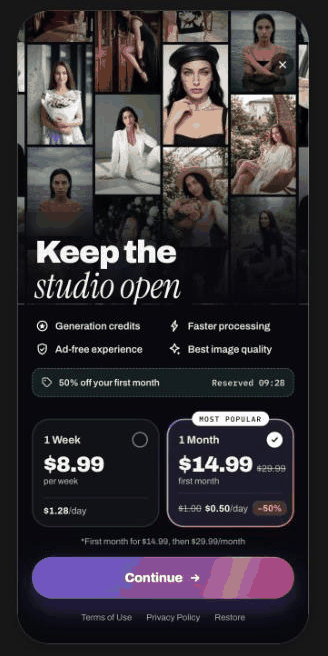
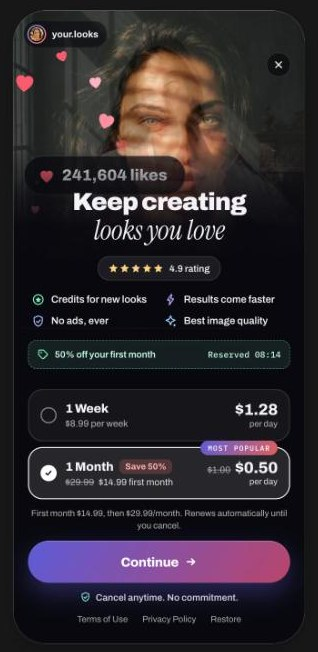
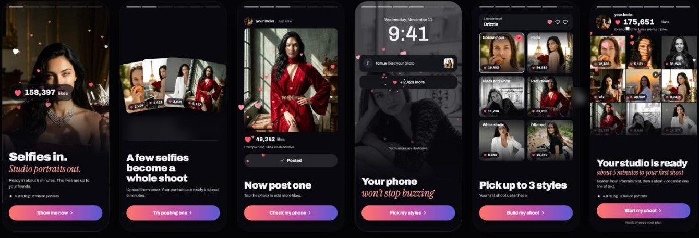

# User acquisition skills by Vlad Yasinski: agent skills for app and subscription growth

User Acquisition Skills is a set of sixteen open agent skills for paid user acquisition, paywalls, onboarding funnels, unit economics, attribution, typed AI decision gates and competitor creative research in app and subscription businesses. They are written by [Vlad Yasinski](https://www.roimobi.com), an AI growth consultant in Warsaw with 10+ years of paid acquisition experience, and work in Claude Code, Codex, Cursor and other agents that read SKILL.md files.

## Try it free in the browser

The skills are the method. The same methods also run as free tools on my site, with no install and no signup:

- [Free ad creative checker](https://www.roimobi.com/tools/ad-checker?utm_source=github&utm_medium=readme&utm_campaign=user-acquisition-skills): paste your ad copy, get a score from 0 to 100 and the fixes, most important first. Built on the typed checks in `jev-marketing-gates`.
- [Free synthetic audience ad test](https://www.roimobi.com/tools/synthetic-audience-ad-test?utm_source=github&utm_medium=readme&utm_campaign=user-acquisition-skills): show one ad or two to 1,000 virtual people and read the funnel per 1,000 virtual impressions, the objections and the verdict. Built on `synthetic-audience-panel`.

## Install

Requires Node.js. Uses the open [`skills` CLI](https://github.com/vercel-labs/skills).

```bash
# Install all skills from this repository (you choose agents interactively)
npx skills add ua5er/user-acquisition-skills

# List what is inside without installing
npx skills add ua5er/user-acquisition-skills --list

# Install one skill into Claude Code, globally, without prompts
npx skills add ua5er/user-acquisition-skills --skill paywall-audit -a claude-code -g -y

# Install everything for every detected agent
npx skills add ua5er/user-acquisition-skills --all
```

Then ask your agent in plain words, for example: "Audit this paywall", "Write kill and scale rules for our Meta campaigns", or "Check why Meta and Stripe disagree on purchases".

## Skills

| Skill | What it does |
|---|---|
| [`ua-kill-scale-rules`](skills/ua-kill-scale-rules/SKILL.md) | Writes kill, scale and budget pacing rules for Meta and TikTok from your CAC target, then applies them to a campaign export. |
| [`paywall-audit`](skills/paywall-audit/SKILL.md) | Audits a subscription paywall or checkout: message match, proof, price display, disclosure, CTA, with a ranked change list and test queue. Adapted in part from two MIT skills (see Credits). |
| [`onboarding-web2app-funnel`](skills/onboarding-web2app-funnel/SKILL.md) | Produces distinct onboarding or web-to-app concepts with hypotheses, measurement plan and test order. |
| [`unit-economics-check`](skills/unit-economics-check/SKILL.md) | Checks CAC, cohort LTV and payback from your own data and sets a safe CAC ceiling. |
| [`attribution-sanity-check`](skills/attribution-sanity-check/SKILL.md) | Reconciles ad platform, MMP, SKAN and backend payments and lists the fixes that matter. |
| [`creative-testing-research`](skills/creative-testing-research/SKILL.md) | Plans a creative testing cycle and researches competitors from public ad libraries only. |
| [`weekly-ua-report`](skills/weekly-ua-report/SKILL.md) | Builds a one-page weekly acquisition report that ends in decisions. |
| [`ai-marketing-system-audit`](skills/ai-marketing-system-audit/SKILL.md) | Maps a marketing system as a loop (acquire, convert, measure, automate, intelligence, decide) and ranks the gaps. |
| [`meta-ads-learning-audit`](skills/meta-ads-learning-audit/SKILL.md) | Audits a Meta ad account stuck in "Learning limited": event volume against the budget learning needs, split signal, CPM of small test ad sets, funnel and CAPI, and a post-mortem table of past campaigns. Works from exports and screenshots, no API token. |
| [`meta-ads-launch-planner`](skills/meta-ads-launch-planner/SKILL.md) | Plans a Meta sales launch that exits learning: budget from target CPA x 50 events a week (with `budget.py`), one broad ad set on CBO, day-by-day decision rules, automated stop and restart rules, scaling schedule, relaunch playbook and a plan document for management. |
| [`meta-creative-testing`](skills/meta-creative-testing/SKILL.md) | Designs creative testing for Meta after Andromeda: which past ads to relaunch and why, three test structures with the cost of an answer, winner, kill and fatigue criteria, a weekly creative flow and a brief template for designers and UGC creators. |
| [`jev-marketing-gates`](skills/jev-marketing-gates/SKILL.md) | Turns one marketing judgment into a typed decision gate with Jev (TypeSafe AI): an LLM or analyst proposes, Jev judges, code decides, a person approves spend and publishing. Four job templates (ad copy judge, comment and DM triage, policy pre-check, creative tagging), a batch runner, a calibration report and offline tests, standard library only. Request shapes follow the vendor docs as of 2026-11-15 and were checked against the live API that day. |
| [`competitor-creative-parser`](skills/competitor-creative-parser/SKILL.md) | Claude + Jev, step 1. Turns competitor ads from public ad libraries or your own files into a tagged dataset and a market snapshot, in a static and a video track: shares per hook, angle, format, offer and CTA, crowded angles, gaps, pacing facts, with small-sample guards and a review queue. Claude drafts a market taxonomy for the category before tagging, and a confirm pass keeps confident choices out of review. |
| [`market-to-creative-brief`](skills/market-to-creative-brief/SKILL.md) | Claude + Jev, step 2. Turns the snapshot and your constraints into production decisions, a static brief for designers and a motion brief for the video team. Code re-checks every cited number, ad id, gap, beat timing and the test budget before the pack renders. |
| [`creative-preflight-panel`](skills/creative-preflight-panel/SKILL.md) | Claude + Jev, step 3. Shows every concept (and every video hook) to 12 to 30 simulated buyer profiles, builds a concept by profile heatmap and gives go, rework or drop with reasons; after launch it checks the panel against your real results. A cheap filter and a signal, not proof of performance. |
| [`synthetic-audience-panel`](skills/synthetic-audience-panel/SKILL.md) | Claude + Jev. Shows one ad or two to about 1,000 virtual people in a few requests: every combination of seven situations and attitudes, with a control group. Returns a funnel per 1,000 virtual impressions, the main objections, readings by kind of person and a verdict for two ads on the same panel. Also reads onboarding screens step by step. Panel answers and a cheap filter, not a forecast of CTR. |

## Claude + Jev: from competitor ads to tested concepts

Three skills work as one system. Claude does what needs eyes and words: it describes every competitor image and video, writes the briefs and writes the buyer profiles. [Jev](https://docs.typesafe.ai), TypeSafe AI's typed-decision model, does what needs the same careful judgment many times: yes/no, choice and score answers with probabilities, at $0.042 per million input tokens (vendor price on 2026-11-15). Code does the counting, thresholds and checks. A person approves anything that is produced, spent or published.

1. **Parse the market** with `competitor-creative-parser`. Capture competitor ads through official routes or your own browsing, Claude describes each one in a fixed template, Jev tags it, code builds `snapshot.json`: what the category runs, what is crowded and where nobody is.
2. **Write the briefs** with `market-to-creative-brief`. Claude picks the moves (enter a gap, out-execute a crowded angle, avoid a risky claim) and writes a static brief and a motion brief with references by ad id. `brief_pack.py` refuses any number the snapshot does not hold.
3. **Pre-flight the concepts** with `creative-preflight-panel`. Every concept meets a simulated buyer panel; code ranks with guards and returns go, rework or drop to the brief pack. Survivors go to the test plan in `meta-creative-testing`. After launch, `panel_vs_results.py` measures how well the panel's order matched real results, so its weight goes up or down.

Every step has a static track and a video track, an offline mock, a smoke test and a spend guard. The [walk-through on a fictional market](examples/competitor-parse-fictional-market.md) shows all three steps with real Jev output on invented ads: 24 ads tagged, 6 decisions, 6 concepts, 144 panel answers, 216,039 input tokens, about $0.009 in Jev spend.

The system has also been run on a real market: 54 ads from the public Meta Ad Library (AI photo editor apps, US, 2026-11-15), anonymised in the [real-market walk-through](examples/competitor-parse-real-market.md). The stock questions failed on real ads, so the parser gained a step where Claude drafts a market taxonomy from the first descriptions, and a confirm pass in the tagger. The whole run, tagging and panel, was 2,091 typed answers and $0.0146 in Jev spend (four earlier pilots added $0.0128). An ad library shows what runs, never spend or results.

## How these were used

Two design explorations for a subscription AI photo app (app name withheld) used these skills. Both are written up with the method, the versions produced and what is still unmeasured:

- [Onboarding redesign: five concepts](examples/onboarding-redesign-subscription-photo-app.md)
- [Paywall redesign: versions V1 to V6 and hero variants](examples/paywall-redesign-subscription-photo-app.md)
- [Synthetic audience panel: two ads on 1,000 virtual people](examples/synthetic-audience-panel-walkthrough.md)

These are design cases. They do not contain measured conversion results. The Claude + Jev walk-throughs above contain no ad results either: one runs on a fictional market, the other on a real ad library capture, which shows what runs and never spend or results.

### Live gallery

**[See all 19 concepts live](https://ua5er.github.io/user-acquisition-skills/#paywalls)**: 14 animated paywalls and 5 onboarding flows you can tap through in the browser. They run on [dc-lite](https://github.com/ua5er/dc-lite), a small open renderer for interactive design boards.

### Previews

Screens from the design boards. The app brand is blurred.

<p>
  
  
</p>



## Principles

- Your data first. The skills do not insert industry benchmarks. Any number in an example is labelled as an example.
- Public data only for competitor research.
- Decisions, not dashboards: every skill ends in an output someone can act on.
- Honest offers: no fake urgency, hidden fees or placeholder proof.

## About the author

Vlad Yasinski is a performance marketer and growth consultant based in Warsaw, Poland (remote; English, Polish, Russian), with 10+ years of paid acquisition experience since 2015. He took two apps to Top-1 in their US App Store categories, managed Facebook and TikTok budgets of up to $1.5M per month at peak, built web funnels end to end (landing pages, Stripe checkout, Meta Pixel and Conversions API, BI and FunnelFox), and rebuilt an unprofitable app portfolio to positive unit economics for a client under NDA. He builds the analytics, funnels and automation around paid acquisition for app and subscription businesses.

- Telegram: [@ua5er](https://www.roimobi.com/tg?src=github-ua-skills)
- Site: [roimobi.com](https://www.roimobi.com/?utm_source=github&utm_medium=readme&utm_campaign=user-acquisition-skills)
- Background and experience: [roimobi.com/about](https://www.roimobi.com/about?utm_source=github&utm_medium=readme&utm_campaign=user-acquisition-skills)
- LinkedIn: [linkedin.com/in/vlad-yasinski-ua5er](https://www.linkedin.com/in/vlad-yasinski-ua5er/)
- Want a review of your own system? [Request an AI Marketing and Growth Audit](https://www.roimobi.com/contact?intent=audit&utm_source=github&utm_medium=readme&utm_campaign=user-acquisition-skills)

## Privacy

The hosted demo at ua5er.github.io counts anonymous page views and contact clicks with PostHog (EU), without cookies or personal data. It honours Do Not Track and Global Privacy Control. Copies you host yourself send nothing.

## Credits and licence

This repository is released under the [MIT licence](LICENSE).

`paywall-audit` is adapted in part from:

- `paywalls` in [coreyhaines31/marketingskills](https://github.com/coreyhaines31/marketingskills), MIT, copyright 2025 Corey Haines.
- `paywall-optimization` in [appeeky/aso-skills](https://github.com/appeeky/aso-skills), MIT, copyright 2026 Erencan.

Their licence texts are in [THIRD_PARTY_NOTICES.md](THIRD_PARTY_NOTICES.md). The other fourteen skills are original. Motion guidance referenced in the paywall case comes from [emilkowalski/skills](https://github.com/emilkowalski/skills) and [ibelick/ui-skills](https://github.com/ibelick/ui-skills), both MIT, and is not included here.

Product and platform names (Meta, TikTok, Stripe, AppsFlyer, Adjust and others) belong to their owners and are used only to describe what the skills work with. This project is not affiliated with or endorsed by them.
